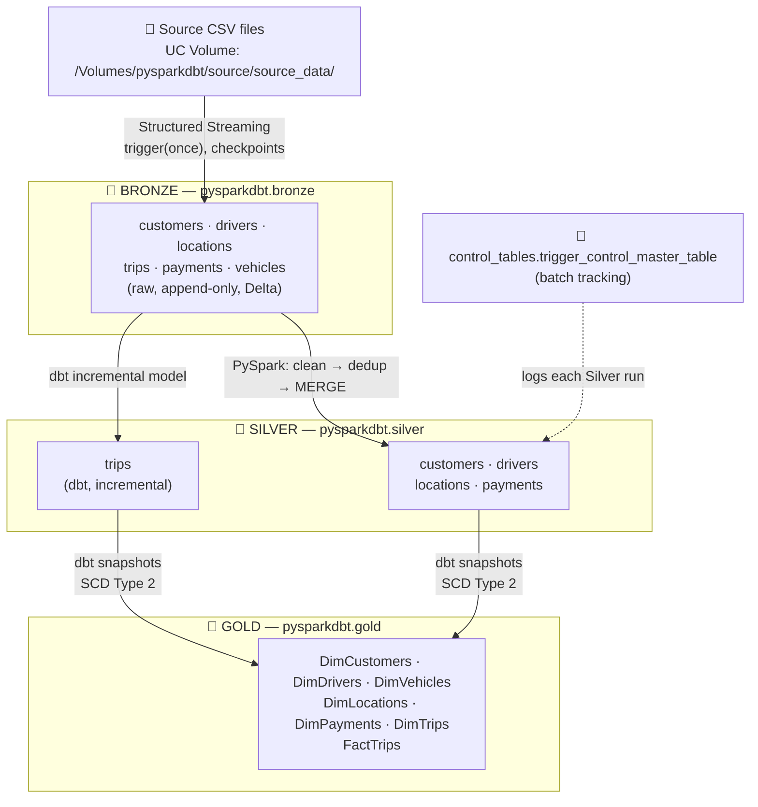
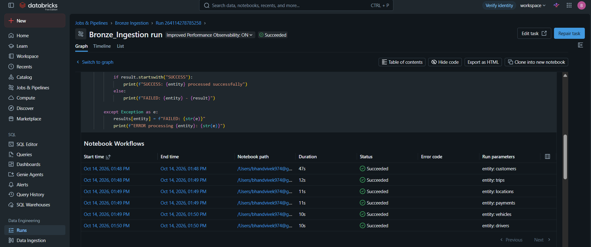
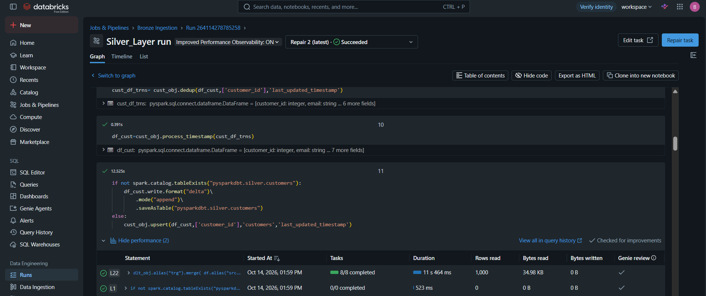
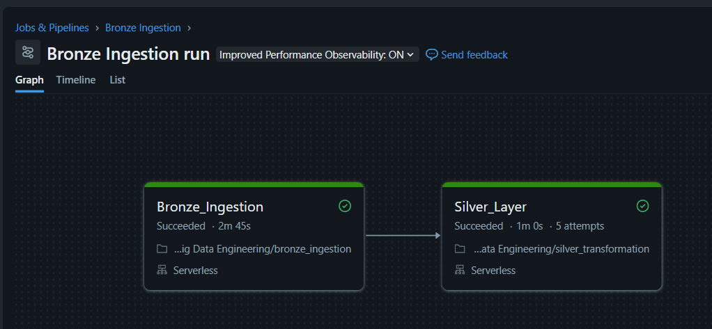
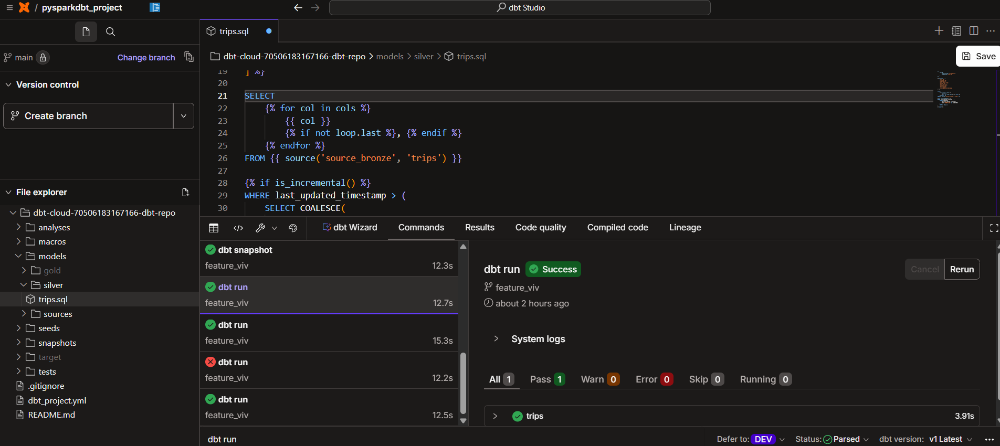
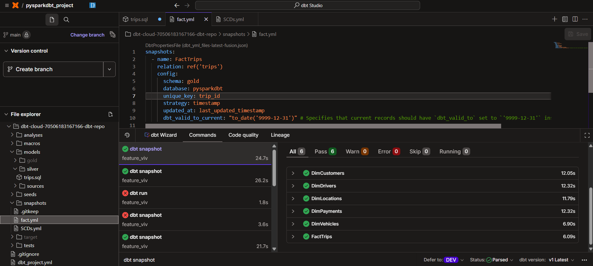

# 🚖 End-to-End Data Engineering Project
### PySpark × dbt on Databricks — Medallion Architecture (Bronze → Silver → Gold)

*An incremental, production-style lakehouse pipeline for a ride/taxi business: streaming ingestion, PySpark cleansing, dbt incremental models and SCD Type 2 history tracking.*

<br>


---

## 📌 Project Overview

This project is a complete **data engineering pipeline** built on **Databricks** for a **ride/taxi-style business**. Raw CSV files arrive in a landing zone and are progressively refined through the **Medallion Architecture**:

| Layer | What it holds | Built with |
|---|---|---|
| 🥉 **Bronze** | Raw data, exactly as received (append-only history) | Spark Structured Streaming + Delta Lake |
| 🥈 **Silver** | Cleaned, de-duplicated, *current-state* data | PySpark (Delta `MERGE`) + dbt incremental model |
| 🥇 **Gold** | Star schema with **full history** (SCD Type 2) | dbt snapshots |

**Business entities (6):** `customers` · `drivers` · `vehicles` · `locations` · `trips` · `payments`

### ✨ Highlights

- ⚡ **Incremental ingestion** with Structured Streaming, checkpoints and `trigger(once=True)` – only new files are processed each run.
- 🔁 **Reusable, parameterized notebooks** – one worker notebook serves all entities.
- 🧹 **Reusable PySpark transformation class** – dedup, audit column and upsert logic shared across entities.
- 🧾 **Control table** that tracks every Silver run (batch id, start/end time, status).
- 🧩 **dbt incremental model** with Jinja and a high-watermark filter for `trips`.
- 🕰️ **SCD Type 2 Gold layer** (6 dimensions + 1 fact) using dbt snapshots with the `timestamp` strategy.
- 🏷️ **Custom `generate_schema_name` macro** so dbt writes directly to the `silver` and `gold` schemas.

---

## 🏗 Architecture



### Unity Catalog layout

```
pysparkdbt (catalog)
├── source (schema)
│   └── source_data (volume)  → customers/ drivers/ locations/ trips/ payments/ vehicles/
├── bronze (schema)           → raw Delta tables + checkpoint/<entity>
├── silver (schema)           → cleaned Delta tables
├── gold (schema)             → Dim* and FactTrips (SCD Type 2)
└── control_tables (schema)   → trigger_control_master_table
```

---

## 🧰 Tech Stack

| Tool | Role in the project |
|---|---|
| **Databricks** | Compute, notebooks, workflows |
| **Unity Catalog** | Governance: `catalog.schema.table` namespace, volumes, lineage |
| **UC Volumes** | Landing zone for raw CSV files and streaming checkpoints |
| **PySpark** | Transformations (cleaning, dedup, derived columns) |
| **Spark Structured Streaming** | Incremental file ingestion into Bronze |
| **Delta Lake** | ACID storage format, `MERGE`, time travel |
| **dbt Cloud** (`dbt-databricks`) | Incremental Silver model + Gold snapshots |
| **SQL + Jinja** | dbt models, macros and templating |
| **Git / GitHub** | Version control |

---

## 📂 Repository Structure

```
DATABRICKS_X-DBT_End_To_End_Data_Engineering_Project/
├── bronze_ingestion.html          # Orchestrator notebook (loops over entities)
├── load_to_bronze.html            # Worker notebook (streaming load per entity)
├── silver_transformation.html     # PySpark Silver notebook
│
└── DBT_CLOUD/                     # dbt project
    ├── dbt_project.yml            # Project config (paths, materializations, schemas)
    ├── analyses/
    │   └── scratch.sql            # Ad-hoc query on bronze trips (compiled only)
    ├── macros/
    │   └── generate_schema_name.sql   # Use exact custom schema names
    ├── models/
    │   ├── sources/
    │   │   └── sources.yml        # Declares bronze + silver source tables
    │   └── silver/
    │       └── trips.sql          # Incremental model → silver.trips
    ├── snapshots/
    │   ├── SCDs.yml               # 6 dimension snapshots → gold.Dim*
    │   └── fact.yml               # Fact snapshot → gold.FactTrips
    ├── seeds/
    └── tests/
```

---

## 📚 Concepts in Short (Theory)

<details>
<summary><b>🏅 Medallion Architecture</b></summary>

A design pattern that organizes data into layers of increasing quality: **Bronze** (raw), **Silver** (cleaned & conformed), **Gold** (business-ready). It separates concerns, makes debugging easy and allows reprocessing downstream layers without going back to the source.
</details>

<details>
<summary><b>🗂 Unity Catalog & Volumes</b></summary>

Databricks' governance layer with a three-level namespace: `catalog.schema.table`. **Volumes** are governed storage for non-tabular files (CSV, JSON, images), accessed through `/Volumes/<catalog>/<schema>/<volume>/`.
</details>

<details>
<summary><b>🔺 Delta Lake</b></summary>

A storage layer on top of Parquet with a transaction log (`_delta_log`). Provides **ACID transactions**, **schema enforcement/evolution**, **MERGE / UPDATE / DELETE**, **time travel**, and unified batch + streaming.
</details>

<details>
<summary><b>🌊 Spark Structured Streaming</b></summary>

Treats a stream as an unbounded table that keeps receiving rows, so the same DataFrame API works for batch and streaming.

| Concept | Meaning | Used here |
|---|---|---|
| Source | Where data is read from | CSV file source (folder per entity) |
| Sink | Where data is written | Delta table |
| Output mode | What is written each trigger | `append` |
| Trigger | When a micro-batch runs | `once=True` (process all new data, then stop) |
| Checkpoint | Tracks processed files → restartable, exactly-once | One folder per entity |

`trigger(once=True)` gives **incremental, batch-style loading** without keeping a cluster running 24×7. (`availableNow=True` is the newer recommended equivalent.) File streams need an explicit schema, so the schema is captured from a one-time batch read with `inferSchema`.
</details>

<details>
<summary><b>🪟 Deduplication with Window Functions</b></summary>

`row_number()` over a window partitioned by the business key and ordered by `last_updated_timestamp DESC`; keeping row number `1` retains the **latest** version of each record (unlike `dropDuplicates`, which keeps an arbitrary row).
</details>

<details>
<summary><b>🔀 Delta MERGE & SCD Type 1</b></summary>

`MERGE` = update if the key matches, insert if not. In Silver, matched rows are overwritten **only when the incoming record is newer**, so the table always holds the latest state (**SCD Type 1**) and late/out-of-order data cannot overwrite newer data.
</details>

<details>
<summary><b>🧱 dbt (data build tool)</b></summary>

The **"T" in ELT**. You write SQL `SELECT` statements (models) plus Jinja; dbt compiles and runs them in the lakehouse in dependency order (`ref()` / `source()` build the DAG). Key ideas used here:

- **Source** – tables not built by dbt (e.g. bronze/silver tables from PySpark).
- **Incremental model** – first run builds everything; later runs only process new/changed rows (`is_incremental()`, `{{ this }}`, `unique_key`).
- **Snapshot** – records changes of a mutable table over time as SCD Type 2.
- **Macro** – reusable Jinja function (`generate_schema_name` override).
- **Config precedence** – in-file `config()` > `dbt_project.yml` > defaults.
</details>

<details>
<summary><b>🕰 SCD Type 2 & dbt Snapshots</b></summary>

| Type | Behaviour |
|---|---|
| Type 1 | Overwrite old value (no history) — *my Silver layer* |
| **Type 2** | Close the old row, insert a new one (full history) — *my Gold layer* |
| Type 3 | Keep previous value in an extra column |

With the **`timestamp` strategy**, dbt compares `updated_at` for each `unique_key`; if newer, the old row is closed (`dbt_valid_to` set) and a new current row is inserted. dbt adds `dbt_scd_id`, `dbt_updated_at`, `dbt_valid_from`, `dbt_valid_to`. Using `dbt_valid_to_current`, current rows get `9999-12-31` instead of `NULL`, which simplifies range queries.
</details>

<details>
<summary><b>⭐ Dimensional Modelling</b></summary>

A **star schema** has a central **fact** table (measurable events such as `distance_km`, `fare_amount`) linked to **dimension** tables (customer, driver, vehicle, location, payment). The **grain** of `FactTrips` is one row per trip version.
</details>

---

## 🛠 What I Built (Step by Step)

### Step 1 – Environment Setup (Unity Catalog)

- Created catalog **`pysparkdbt`** with schemas `source`, `bronze`, `silver`, `gold` and `control_tables`.
- Created the volume **`source_data`** with one sub-folder per entity (each entity has its own schema and its own checkpoint).

---

### Step 2 – Bronze Layer (Streaming Ingestion)

Bronze copies data **as-is** into Delta tables, incrementally, with no business logic.

**Two-notebook pattern**

| Notebook | Role |
|---|---|
| `bronze_ingestion` | *Orchestrator* – loops over the 6 entities and calls the worker via `dbutils.notebook.run`; one entity failing does not stop the others |
| `load_to_bronze` | *Worker* – receives `entity` through a widget, resolves source path / target table, and runs the stream |

**Core streaming logic**

```python
# 1) Batch read once to capture the schema (streaming needs an explicit schema)
df_batch = (spark.read.format("csv")
            .option("header", "true").option("inferSchema", "true")
            .load(source_path))
schema_entity = df_batch.schema

# 2) Streaming read
df = (spark.readStream.format("csv")
      .option("header", "true").schema(schema_entity)
      .load(source_path))

# 3) Streaming write to Delta (incremental, exactly-once)
query = (df.writeStream.format("delta")
         .outputMode("append")
         .option("checkpointLocation", f"/Volumes/pysparkdbt/bronze/checkpoint/{entity}")
         .trigger(once=True)
         .toTable(target_table))
query.awaitTermination()
dbutils.notebook.exit(f"SUCCESS: {entity}")
```

**Result:** re-running with no new files adds nothing (checkpoint knows what was processed); updated records simply appear as additional rows – de-duplication is Silver's job.


---

### Step 3 – Control Table & Batch Tracking

Each Silver run is logged in `pysparkdbt.control_tables.trigger_control_master_table`.

| Column | Meaning |
|---|---|
| `batch_id` | Zero-padded run number (`0000`, `0001`, …) |
| `business_date` | Business date of the run |
| `run_start_time` / `run_end_time` | Run boundaries (`run_end_time` is null while running) |
| `status` | `RUNNING` → `SUCCESS` |

A row is inserted as `RUNNING` at the start and updated to `SUCCESS` at the end with the Delta `update` API. A row stuck in `RUNNING` immediately reveals a failed or interrupted run.

---

### Step 4 – Silver Layer (PySpark)

A reusable **`transformations`** class keeps logic consistent across entities:

```python
class transformations:

    def dedup(self, df: DataFrame, dedup_cols: List, cdc: str):
        df = df.withColumn("dedupKey", concat(*dedup_cols))
        df = df.withColumn("dedupCounts",
                row_number().over(Window.partitionBy("dedupKey").orderBy(col(cdc).desc())))
        return df.filter(col("dedupCounts") == 1).drop("dedupKey", "dedupCounts")

    def process_timestamp(self, df):
        return df.withColumn("process_timestamp", current_timestamp())

    def upsert(self, df, key_cols, table, cdc):
        merge_condition = ' AND '.join([f"src.{i}=trg.{i}" for i in key_cols])
        DeltaTable.forName(spark, f"pysparkdbt.silver.{table}").alias("trg") \
            .merge(df.alias("src"), merge_condition) \
            .whenMatchedUpdateAll(condition=f"src.{cdc} > trg.{cdc}") \
            .whenNotMatchedInsertAll() \
            .execute()
```

**Load pattern (all entities):** if the Silver table does not exist → create it; otherwise → `MERGE`.

| Entity | Business key | Cleaning / derived columns |
|---|---|---|
| `customers` | `customer_id` | `domain` (from email), digits-only `phone_number`, `full_name` |
| `drivers` | `driver_id` | digits-only `phone_number`, `full_name` |
| `locations` | `location_id` | dedup only |
| `payments` | `payment_id` | `online_payments_status` (`online-success` / `online-failure` / `online-pending` / `offline`) |
| `trips` | `trip_id` | handled with **dbt** (next step) |

All tables share: dedup on `last_updated_timestamp`, a `process_timestamp` audit column and the merge condition `src.last_updated_timestamp > trg.last_updated_timestamp`.




---

### Step 5 – Silver Trips (dbt Incremental Model)

`models/silver/trips.sql` uses a **Jinja column list** and a **high-watermark filter**:

```sql
{{ config(materialized='incremental', unique_key='trip_id') }}



SELECT
    
        {{ col }}, 
    
FROM {{ source('source_bronze', 'trips') }}


WHERE last_updated_timestamp > (
    SELECT COALESCE(MAX(last_updated_timestamp), CAST('1900-01-01' AS TIMESTAMP))
    FROM {{ this }}
)

```

| Run | Behaviour |
|---|---|
| First run | Full `CREATE TABLE AS SELECT` |
| Next runs | Select only rows newer than the current max timestamp, **merge** on `trip_id` |
| `--full-refresh` | Rebuild from scratch |

**Supporting pieces**

- **`generate_schema_name` macro** – returns the custom schema verbatim (instead of `<target>_<custom>`), so models and snapshots land in the exact `silver` and `gold` schemas.
- **`sources.yml`** – declares `source_bronze` (`trips`) and `source_silver` (`customers`, `payments`, `locations`, `vehicles`, `drivers`, `trips`) for lineage and a single place to change names.


---

### Step 6 – Gold Layer (dbt Snapshots, SCD Type 2)

Six **dimension snapshots** (`SCDs.yml`) and one **fact snapshot** (`fact.yml`) write to `pysparkdbt.gold`:

| Gold table | Built from | `unique_key` |
|---|---|---|
| `DimCustomers` | `source_silver.customers` | `customer_id` |
| `DimDrivers` | `source_silver.drivers` | `driver_id` |
| `DimVehicles` | `source_silver.vehicles` | `vehicle_id` |
| `DimLocations` | `source_silver.locations` | `location_id` |
| `DimPayments` | `source_silver.payments` | `payment_id` |
| `DimTrips` | `source_silver.trips` | `trip_id` |
| `FactTrips` | `ref('trips')` (dbt model) | `trip_id` |

```yaml
snapshots:
  - name: DimCustomers
    relation: source('source_silver', 'customers')
    config:
      schema: gold
      database: pysparkdbt
      unique_key: customer_id
      strategy: timestamp
      updated_at: last_updated_timestamp
      dbt_valid_to_current: "to_date('9999-12-31')"
```

`FactTrips` uses `ref('trips')`, so dbt builds the `trips` model first and then snapshots it.

**Example – a customer changes email**

| customer_id | email | dbt_valid_from | dbt_valid_to |
|---|---|---|---|
| C1 | ravi@old.com | 2026-01-10 | **2026-03-15** *(closed)* |
| C1 | ravi@new.com | 2026-03-15 | **9999-12-31** *(current)* |

```sql
-- Current version only
SELECT * FROM pysparkdbt.gold.DimCustomers WHERE dbt_valid_to = '9999-12-31';

-- Point-in-time lookup
SELECT * FROM pysparkdbt.gold.DimCustomers
WHERE customer_id = 'C1'
  AND '2026-02-01' >= dbt_valid_from AND '2026-02-01' < dbt_valid_to;
```

> **Silver (SCD1) → Gold (SCD2):** Silver stores the *latest* state; Gold snapshots detect changes flowing out of Silver and preserve *history*. The same `last_updated_timestamp` column drives dedup, merge and snapshot change detection.


---

## 🔄 End-to-End Data Flow

| # | Stage | Tool | Input → Output |
|---|---|---|---|
| 1 | Ingest | Databricks + Structured Streaming | CSVs in UC Volume → `pysparkdbt.bronze.*` |
| 2 | Silver (PySpark) | `silver_transformation` notebook | Bronze → `pysparkdbt.silver.*` + control table logging |
| 3 | Silver (dbt) | `models/silver/trips.sql` | `bronze.trips` → incremental `silver.trips` |
| 4 | Gold (dbt) | `snapshots/SCDs.yml`, `fact.yml` | Silver → `pysparkdbt.gold.Dim*`, `FactTrips` |

**dbt dependency graph**

```
source_bronze.trips --> [model] trips --> [snapshot] FactTrips
source_silver.customers --> [snapshot] DimCustomers
source_silver.locations --> [snapshot] DimLocations
source_silver.drivers   --> [snapshot] DimDrivers
source_silver.payments  --> [snapshot] DimPayments
source_silver.vehicles  --> [snapshot] DimVehicles
source_silver.trips     --> [snapshot] DimTrips
```

**What happens when a trip's fare is corrected in a new source file?**
1. Streaming appends the new row to `bronze.trips`.
2. Silver merges it on `trip_id` (newer `last_updated_timestamp` wins).
3. `dbt snapshot` closes the old `FactTrips` row and inserts a new current row with the corrected fare.

---

## ▶️ How to Run

**Prerequisites:** a Databricks workspace with Unity Catalog, a dbt Cloud account connected to Databricks (`dbt-databricks` adapter) and this repository linked to dbt Cloud (project subdirectory: `DBT_CLOUD`).

```text
1. Create the catalog `pysparkdbt` and the schemas: source, bronze, silver, gold, control_tables
2. Create the volume `source_data` and the six entity sub-folders; upload the CSV files
3. Import the notebooks into Databricks (bronze_ingestion, load_to_bronze, silver_transformation)
4. Run bronze_ingestion            → loads all entities into Bronze
5. Run silver_transformation       → builds Silver + writes the control-table record
6. In dbt Cloud:
      dbt run --select trips       → incremental silver.trips
      dbt snapshot                 → Gold dimensions + FactTrips (SCD Type 2)
   (or simply: dbt build)
```

| dbt command | Effect |
|---|---|
| `dbt run` | Builds models → `silver.trips` |
| `dbt snapshot` | Runs the 7 snapshots → Gold tables |
| `dbt build` | Models + snapshots (+ tests/seeds) in DAG order |
| `dbt run --full-refresh` | Rebuilds the incremental model from scratch |

---

## ✅ Advantages of This Design

| Advantage | How it is achieved |
|---|---|
| **Incremental & cost-efficient** | Streaming checkpoints in Bronze; watermark-based incremental model in dbt; no always-on cluster |
| **Idempotent / re-runnable** | Checkpoints, dedup and key-based `MERGE` prevent duplicates |
| **Auditability & replay** | Raw Bronze history is preserved; Silver can be rebuilt without touching the source |
| **Full history for analytics** | SCD Type 2 Gold tables with validity windows enable point-in-time analysis |
| **Reusable & maintainable** | One parameterized ingestion notebook; one transformation class; Jinja column list |
| **Fault isolation** | One entity failing in Bronze does not stop the others |
| **Observability** | Control table records batch id, timings and status for every run |
| **Late-data safe (Silver)** | Merge only updates when the incoming `last_updated_timestamp` is newer |
| **Governed** | Unity Catalog provides a 3-level namespace, access control and lineage |
| **Documented lineage** | dbt `source()` / `ref()` produce a clear DAG |

---

## 🎓 What I Learned

- Designing a **Medallion lakehouse** and deciding what belongs in each layer.
- Using **Structured Streaming** for *incremental batch* ingestion (checkpoints, triggers, output modes, `awaitTermination`) and why file streams need an explicit schema.
- Orchestrating **parameterized notebooks** with `dbutils.widgets` and `dbutils.notebook.run` / `exit`.
- Implementing **deduplication with window functions** and **upserts with Delta `MERGE`** (SCD Type 1), including protection against out-of-order data.
- Building a **control table** for run tracking and monitoring.
- Writing **dbt incremental models** with Jinja (`config`, `set`, `for`, `is_incremental`, `this`) and the high-watermark pattern.
- Using **dbt snapshots** to implement **SCD Type 2**, and understanding `dbt_valid_from`, `dbt_valid_to` and `dbt_valid_to_current`.
- Overriding dbt built-in behaviour with a custom **`generate_schema_name` macro**.
- Applying **dimensional modelling** (star schema, fact vs dimension, grain, surrogate keys).
- Combining **PySpark and dbt** in one pipeline, and understanding when each tool fits best.
- Limitations of each pattern: watermark filters miss late-arriving older records; snapshots capture state only when they run, so job frequency sets history granularity.

---

## 🚀 Future Improvements

- Add dbt **tests** (`unique`, `not_null`, `relationships`) and source freshness checks.
- Replace `trigger(once=True)` with `trigger(availableNow=True)`.
- Orchestrate the whole flow with **Databricks Workflows** and schedule dbt Cloud jobs.
- Add data-quality checks / quarantine handling for bad records in Silver.
- Build BI dashboards on the Gold layer.
- Add CI (dbt Cloud CI jobs) on pull requests.

---

## 👤 Author

**Your Name**
- 💼 LinkedIn: [your-linkedin-url](https://www.linkedin.com/)
- 🐙 GitHub: [your-github-username](https://github.com/)
- 📧 Email: your.email@example.com

---

<div align="center">

⭐ If you found this project useful, please consider giving it a star!

</div>
